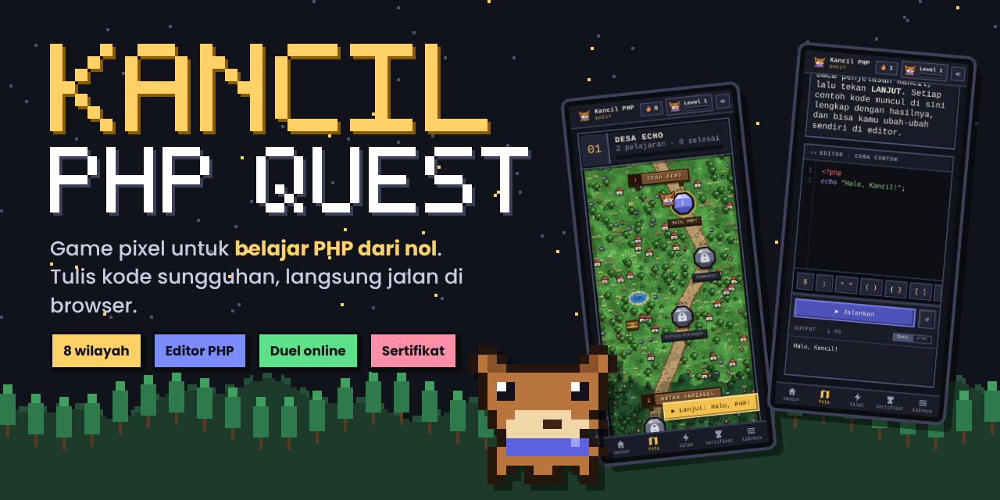
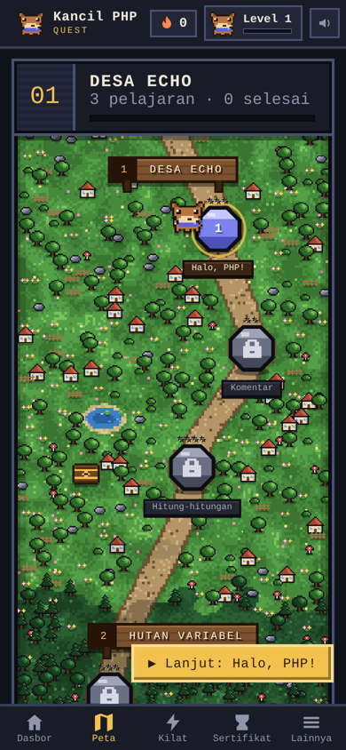
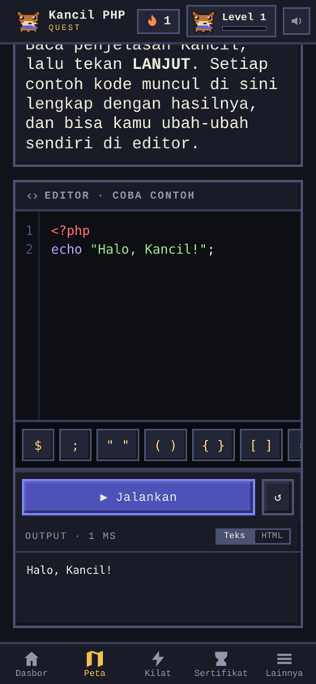
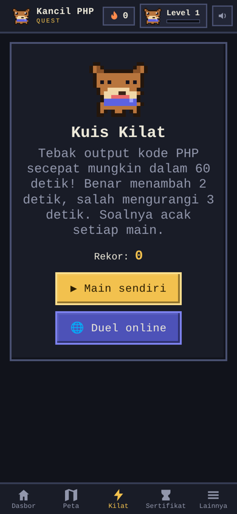
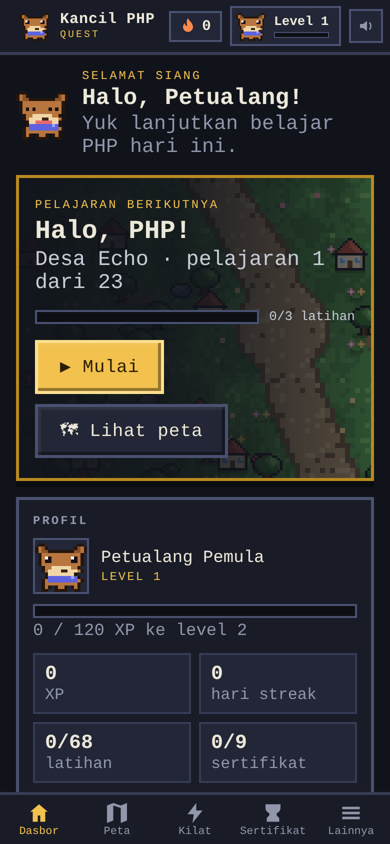
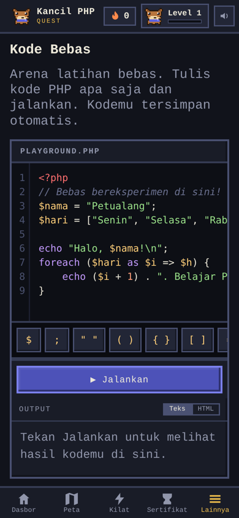
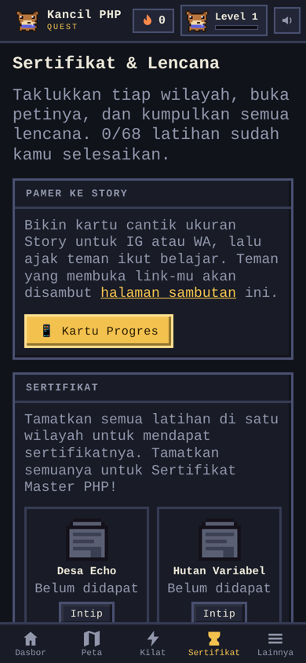

<p align="center">
  
</p>

<p align="center">
  <a href="#"></a>
  
  
</p>

<p align="center">
  
  
  
  
  
  
</p>

---

Belajar PHP biasanya dimulai dengan teori panjang dan instalasi server. **Kancil PHP Quest** membalik urutannya: pemain langsung menulis kode PHP sungguhan di dalam game, menekan *Jalankan*, dan melihat hasilnya saat itu juga. Semuanya berjalan di browser, termasuk di HP.

Pemain ditemani Kancil, si pemandu, menjelajahi 8 wilayah dari kode pertama sampai OOP. Setiap jawaban diperiksa otomatis, jadi tidak bisa diakali dengan sekadar mengetik hasil akhirnya.

## Tampilan

<table>
  <tr>
    <td align="center"><br><b>Peta petualangan</b><br><sub>Wilayah baru terbuka setelah tamat</sub></td>
    <td align="center"><br><b>Editor PHP</b><br><sub>Tulis, jalankan, langsung dicek</sub></td>
    <td align="center"><br><b>Kuis Kilat & Duel</b><br><sub>Adu cepat, sendiri atau lawan teman</sub></td>
  </tr>
  <tr>
    <td align="center"><br><b>Dasbor</b><br><sub>XP, level, dan streak harian</sub></td>
    <td align="center"><br><b>Kode Bebas</b><br><sub>Tempat bereksperimen</sub></td>
    <td align="center"><br><b>Lencana & Sertifikat</b><br><sub>Hadiah tiap wilayah tamat</sub></td>
  </tr>
</table>

## Peta petualangan

| | Wilayah | Yang dipelajari |
|:-:|---|---|
| 1 | **Desa Echo** | `echo`, teks, tag PHP |
| 2 | **Hutan Variabel** | variabel dan tipe data |
| 3 | **Sungai Logika** | `if`, `else`, perbandingan |
| 4 | **Gua Perulangan** | `for`, `while`, `foreach` |
| 5 | **Pasar Array** | array dan fungsi array |
| 6 | **Menara Fungsi** | membuat dan memanggil fungsi |
| 7 | **Kastil OOP** | class, object, method |
| 8 | **Arena Bos** | tantangan gabungan |

## Yang menarik di balik layar

- **Interpreter PHP mini buatan sendiri** (`sumber/php.js`). Browser tidak bisa menjalankan PHP, jadi game ini membawa "mesin PHP" kecilnya sendiri yang ditulis dalam JavaScript. Mesin ini membaca kode pemain, menjalankannya, dan menampilkan output-nya.
- **Pemeriksa jawaban anti-curang.** Kode pemain dijalankan ulang dengan data yang diubah-ubah. Kalau pemain hanya mengetik hasil akhirnya, jawabannya ketahuan salah.
- **Satu file saja.** Seluruh game (tampilan, materi, gambar pixel, suara) digabung jadi satu `index.html` oleh `build.py`, jadi hosting-nya cukup upload satu file.
- **Gambar dan suara dibuat oleh kode.** Semua karakter pixel digambar lewat kode dan semua efek suara dibuat langsung dengan WebAudio, tanpa file gambar atau audio terpisah.

## Struktur folder

```
index.html            game lengkap (file ini yang di-hosting)
SUPABASE-ULASAN.sql   tabel ulasan & saran untuk Supabase
assets/               gambar untuk README
sumber/
  app.html            tampilan dan logika game
  lessons.js          materi dan soal
  steps.js            langkah-langkah pelajaran
  php.js              interpreter PHP mini
  check.js            pemeriksa jawaban
  build.py            menggabungkan semua file jadi index.html
  verify.js           tes otomatis semua kunci jawaban
```

## Coba sendiri

```bash
# cukup buka file ini di browser, tanpa server
index.html

# setelah mengubah file di sumber/, gabungkan ulang:
python3 sumber/build.py
```

---

<p align="center"><sub>Bebas dipakai dan dipelajari di bawah <a href="LICENSE">lisensi MIT</a>. Kalau kamu memakainya, cantumkan link ke repo ini, ya.</sub></p>
